# Especificación Técnica y Funcional del Sistema: Torneo Eliminatorias Mundial (FIFA PS4)

Este documento detalla de forma exhaustiva la arquitectura, el flujo de datos, las estructuras de estado y el comportamiento exacto de cada componente, hook, servicio y utilidad del proyecto **Eliminatorias FIFA PS4**, incluyendo el **Sistema de Identidad Híbrida (Google Auth + Registro Manual)** y el **EA FC Analytics & Player Hub**.

---

## 1. Visión General y Flujo de Arquitectura (100% Compatible con Firebase Spark)

La aplicación es una **SPA (Single Page Application)** construida con **React 18**, **Vite** y **Tailwind CSS**, conectada en tiempo real a **Firebase Cloud Firestore** y **Firebase Authentication (Google Sign-In)**, con respaldo offline automático en `localStorage`.

```mermaid
flowchart TD
    subgraph UI["Capa de Presentación (React Components)"]
        App["App.jsx (Orquestador Principal)"]
        Header["Header.jsx (Cabecera, Progreso y Botón Google)"]
        PinModal["AdminPinModal.jsx (Autenticación PIN Admin)"]
        GoogleModal["GoogleProfileModal.jsx (Login Google y Reclamar Perfil)"]
        Setup["TournamentSetup.jsx (Fase 1: Registro Híbrido 16 Jugadores)"]
        Attendance["AttendancePanel.jsx (Panel de Asistencia Diaria)"]
        ScoreCard["ScoreSubmissionCard.jsx (HUD Carga de Marcador)"]
        Leaderboard["LeaderboardTable.jsx (Tabla de Posiciones en Vivo)"]
        Analytics["AnalyticsDashboard.jsx (Carta Pro EA FC, Gráficos SVG, H2H y Récords)"]
        Fixture["FixtureViewer.jsx (Control y Validación de Fixture)"]
        Toast["NotificationToast.jsx (Alertas Flotantes)"]
    end

    subgraph Logic["Capa de Estado y Lógica de Negocio (Hooks & Utils)"]
        useAdmin["useAdminRole.js (Sesión Admin por PIN)"]
        useUser["useUserAuth.js (Google Auth + Simulador Local)"]
        useTour["useTournament.js (Estado Central, Perfiles y Récords)"]
        Calc["tournamentCalculations.js (Motor de Tabla y Analítica Avanzada)"]
        Mock["mockTournamentData.js (Algoritmo de Berger 120 Partidos)"]
    end

    subgraph Data["Capa de Persistencia (Plan Spark Gratuito)"]
        FBService["tournamentService.js & config.js"]
        FBAuth[("Firebase Auth (Google Provider)")]
        Firestore[("Cloud Firestore (Doc: EliminatoriasFC)")]
        LS[("localStorage (Fallback Offline)")]
    end

    App --> Header
    App --> PinModal
    App --> GoogleModal
    App --> Setup
    App --> Attendance
    App --> ScoreCard
    App --> Leaderboard
    App --> Analytics
    App --> Fixture
    App --> Toast

    App --> useAdmin
    App --> useUser
    App --> useTour
    useUser <--> FBAuth
    useTour --> Calc
    useTour --> Mock
    useTour --> FBService
    FBService <--> Firestore
    useTour <--> LS
```



---

## 2. Estructura de Datos Principal (Optimizada para Plan Spark)

Para mantener el consumo de Firestore al mínimo absoluto (**1 sola lectura de documento al abrir la aplicación**), todo el estado del torneo y el historial acumulado de carrera se almacenan en el documento `tournaments/EliminatoriasFC` (y en `localStorage` bajo `fifa_ps4_local_fallback_v1`):

### 2.1. Objeto Jugador Híbrido (`players[]`)
Soporta tanto jugadores inscritos con **Google Auth** como jugadores agregados **manualmente** por el administrador (y permite que un jugador manual sea "reclamado" después por una cuenta de Google):
```json
{
  "id": "p1710000000-abcd",
  "name": "Noel",
  "tag": "NOEL",
  "favoriteTeam": "Real Madrid",
  "color": "#00f59b",
  "authType": "google",
  "uid": "google-uid-12345",
  "email": "noel@gmail.com",
  "photoURL": "https://lh3.googleusercontent.com/...",
  "claimedAt": "2026-10-18T10:30:00.000Z"
}
```

### 2.2. Objeto Partido (`matches[]` — 120 elementos)
Generado mediante el **Algoritmo de Berger** (15 fechas × 8 partidos por fecha):
```json
{
  "id": "M001",
  "round": 1,
  "homePlayerId": "p16",
  "awayPlayerId": "p1",
  "homePlayerName": "Giorgio",
  "awayPlayerName": "Noel",
  "homeTeam": "Aston Villa",
  "awayTeam": "Real Madrid",
  "jugado": true,
  "golesLocal": 3,
  "golesVisitante": 1,
  "playedAt": "2026-10-18T10:00:00.000Z"
}
```

### 2.3. Récord Histórico de Carrera (`careerHistory{}`)
Mapa persistido dentro del mismo documento que acumula las estadísticas históricas de cada jugador (identificado por `uid_<googleUid>` o `name_<nombre>`) cuando un torneo se archiva/reinicia:
```json
{
  "uid_google-uid-12345": {
    "playerName": "Noel",
    "linkedEmail": "noel@gmail.com",
    "tournamentsPlayed": 2,
    "titlesWon": 1,
    "worldCupQualifications": 2,
    "pj": 30,
    "pg": 22,
    "pe": 4,
    "pp": 4,
    "gf": 68,
    "gc": 25,
    "pts": 70,
    "cleanSheets": 9,
    "lastArchivedAt": "2026-10-18T10:00:00.000Z"
  }
}
```

---

## 3. Especificación Detallada por Componente Visual (`src/components/`)

### 3.1. Orquestador Principal — [`App.jsx`](file:///c:/proyectos/EliminatoriasMundial/src/App.jsx)
Conecta los tres hooks principales: [`useAdminRole`](file:///c:/proyectos/EliminatoriasMundial/src/hooks/useAdminRole.js), [`useUserAuth`](file:///c:/proyectos/EliminatoriasMundial/src/hooks/useUserAuth.js) y [`useTournament`](file:///c:/proyectos/EliminatoriasMundial/src/hooks/useTournament.js).
- **Fase 1 (`!isTournamentStarted`)**: Muestra [`TournamentSetup`](file:///c:/proyectos/EliminatoriasMundial/src/components/TournamentSetup.jsx) tanto para el Administrador como para los participantes, permitiendo inscripción con Google, reclamo de perfiles manuales y registro manual por parte del Admin.
- **Fase 2 (`isTournamentStarted`)**: Renderiza en orden:
  1. Barra de estado y lista desplegable de los 16 participantes.
  2. [`AttendancePanel`](file:///c:/proyectos/EliminatoriasMundial/src/components/AttendancePanel.jsx) (Panel de Asistencia Diaria).
  3. [`ScoreSubmissionCard`](file:///c:/proyectos/EliminatoriasMundial/src/components/ScoreSubmissionCard.jsx) (Módulo de Carga en Vivo, exclusivo para `isAdmin`).
  4. [`LeaderboardTable`](file:///c:/proyectos/EliminatoriasMundial/src/components/LeaderboardTable.jsx) (Tabla de Posiciones en Tiempo Real).
  5. [`AnalyticsDashboard`](file:///c:/proyectos/EliminatoriasMundial/src/components/AnalyticsDashboard.jsx) (EA FC Analytics & Player Hub).
  6. [`FixtureViewer`](file:///c:/proyectos/EliminatoriasMundial/src/components/FixtureViewer.jsx) (Módulo de Control y Validación de Fixture).

---

### 3.2. Cabecera Global Sticky — [`Header.jsx`](file:///c:/proyectos/EliminatoriasMundial/src/components/Header.jsx)
- Muestra el estado de conexión con Firebase (`En Línea`, `Sincronizando...`, `Offline`).
- Muestra la barra de progreso de los 120 partidos (en Fase 2) o de los 16 cupos (en Fase 1).
- **Botón `Conectar Google` / Perfil Vinculado**: Abre el modal [`GoogleProfileModal`](file:///c:/proyectos/EliminatoriasMundial/src/components/GoogleProfileModal.jsx) y muestra la foto de Google del usuario y si ya tiene un jugador vinculado (`✓ Perfil Vinculado`).
- **Botón `Admin` / `Admin Activo`**: Abre [`AdminPinModal`](file:///c:/proyectos/EliminatoriasMundial/src/components/AdminPinModal.jsx) para desbloquear los controles operativos con PIN.

---

### 3.3. Modal de Perfil Google y "Reclamar Perfil" — [`GoogleProfileModal.jsx`](file:///c:/proyectos/EliminatoriasMundial/src/components/GoogleProfileModal.jsx)
Gestiona la identidad del participante sin fricción:
1. **Inicio de Sesión con Google (`loginWithGoogle`)**: Abre el popup oficial de Google Auth.
2. **Simulador de Perfil Local (`loginWithQuickProfile`)**: Si el administrador está haciendo pruebas locales o aún no ha habilitado el proveedor Google en Firebase Console, permite simular cualquier cuenta de usuario al instante.
3. **Auto-Inscripción en Fase 1 (`onSelfRegister`)**: Si el torneo no ha empezado y hay cupos libres, el usuario escribe su apodo y su equipo favorito y queda inscrito con su foto y UID de Google.
4. **Reclamar Jugador Manual (`onClaimProfile`)**: Si el Admin creó al jugador manualmente (ej. *"Jorge - Manchester City"*), el usuario lo selecciona de la lista de jugadores no vinculados y lo asocia a su cuenta de Google en 1 clic, heredando todas sus estadísticas actuales e históricas.

---

### 3.4. Configuración Híbrida de Participantes (Fase 1) — [`TournamentSetup.jsx`](file:///c:/proyectos/EliminatoriasMundial/src/components/TournamentSetup.jsx)
- **Bloque A (Para todos los usuarios)**: Tarjeta de inscripción rápida con Google.
- **Bloque B (Exclusivo Admin)**:
  - Formulario de registro manual tradicional (*Nombre del Jugador* + *Equipo Seleccionado*).
  - **Botón `⚡ Cargar 16 Amigos Base`**: Carga instantáneamente los 16 jugadores de [`INITIAL_PLAYERS`](file:///c:/proyectos/EliminatoriasMundial/src/data/mockTournamentData.js#L6-L23).
  - **Botón `📊 Cargar Demo (28 Partidos y Gráficos)`**: Inicia el torneo con 28 resultados realistas pre-cargados para probar de inmediato las tablas y todos los gráficos del Analytics Hub.
- **Bloque C (Grilla de 16 Cupos en Vivo)**: Muestra qué jugadores fueron registrados vía `Google ✓` (con su foto) y cuáles son `Manual` (incluyendo un botón directo `Soy yo · Vincular mi Google`).

---

### 3.5. Panel de Asistencia Diaria — [`AttendancePanel.jsx`](file:///c:/proyectos/EliminatoriasMundial/src/components/AttendancePanel.jsx)
- Permite al Admin marcar quiénes están presentes hoy en la casa (individualmente o con *Marcar Todos*, *Desmarcar Todos* y *Simular 8 en Casa*).
- Respeta `readOnly={!isAdmin}` ocultando los botones de modificación a los espectadores y deshabilitando el clic sobre las píldoras.
- Muestra 3 KPIs en tiempo real: **Partidos Listos Para Jugar Hoy**, **Jugadores en la Casa (`X de 16`)** y **Garantía de Integridad (`pendientes` sin duplicados)**.

---

### 3.6. Módulo de Carga de Resultado Activo — [`ScoreSubmissionCard.jsx`](file:///c:/proyectos/EliminatoriasMundial/src/components/ScoreSubmissionCard.jsx)
- Exclusivo para el Administrador (`isAdmin === true`).
- Selector de partido agrupado en *"Sugeridos Hoy (Ambos en casa)"* y *"Todos los Pendientes del Torneo"*, más botón `Aleatorio`.
- Controles `-` y `+` para goles de Local y Visitante. Al guardar, actualiza Firestore y selecciona automáticamente el siguiente partido sugerido.

---

### 3.7. Tabla de Posiciones en Tiempo Real — [`LeaderboardTable.jsx`](file:///c:/proyectos/EliminatoriasMundial/src/components/LeaderboardTable.jsx)
- Ordenamiento estricto: `1º PTS > 2º DG > 3º GF > 4º PG > 5º Nombre`.
- Muestra foto de Google (si está vinculado), insignia `★ TÚ` para el jugador conectado, badge `HOY` si está en la casa, `[ZONA MUNDIAL]` (Top 8) vs `[ELIMINADO]` (9–16), racha de últimos 5 partidos (`W/D/L`) y la **Línea de Corte Visual** entre el puesto 8 y 9.
- Incluye columna `PERFIL` con botón **`📊 Stats`** que selecciona al jugador y desplaza suavemente la pantalla hacia su Carta Pro en el Analytics Hub.

---

### 3.8. EA FC Analytics & Player Hub — [`AnalyticsDashboard.jsx`](file:///c:/proyectos/EliminatoriasMundial/src/components/AnalyticsDashboard.jsx)
Módulo profesional de visualización de datos y gráficos construido con **SVG puro reactivo** (sin dependencias pesadas), dividido en **3 vistas**:

1. **Vista 1: `Carta Pro & Gráficos` (`activeView === 'perfil'`)**:
   - **Carta Pro Estilo EA FC 26 Ultimate Team**: Calcula dinámicamente la **Media General (`OVR` 55–99)** y 6 atributos (`ATA`, `DEF`, `EFE`, `FOR`, `LOC`, `VIS`) según el desempeño real del jugador.
   - **Gráfico de Radar Hexagonal (`HexRadarChart`)**: Polígono táctico de 6 ejes.
   - **Gráfico de Dona (`WinDistributionDonut`)**: Porcentaje de Efectividad y proporción visual de Partidos Ganados, Empatados y Perdidos, más comparativa de puntos como **Local vs Visitante**.
   - **Gráfico de Área/Línea (`PointsProgressionChart`)**: Curva cronológica de puntos acumulados fecha por fecha con puntos coloreados según resultado (`W/D/L`).
   - **Gráfico de Barras Dual por Partido**: Compara los goles anotados (verde) vs goles recibidos (rojo) contra cada rival enfrentado.
   - **Panel de Récord Histórico de Carrera & Hitos**: Combina torneos anteriores + torneo actual (*Récord Histórico V-E-D*, *Goles de Carrera*, *Mayor Victoria*, *Peor Derrota*, *Mejor Racha* y *Clasificaciones al Mundial Top 8*).
2. **Vista 2: `Cara a Cara (VS / H2H)` (`activeView === 'h2h'`)**:
   - Permite enfrentar a cualquier **Jugador 1 (Verde Neón)** contra **Jugador 2 (Azul Cielo)**.
   - Superpone ambos polígonos en el **Radar Hexagonal Dual**.
   - Muestra el marcador (o fecha pendiente) de su enfrentamiento directo en el torneo y barras comparativas lado a lado (`PTS`, `% Efectividad`, `PG`, `GF`, `Goles/PJ`, `Vallas Invictas`, `OVR`).
3. **Vista 3: `Récords y Líderes del Torneo` (`activeView === 'global'`)**:
   - **4 Tarjetas de Premios**: 👟 *Bota de Oro (Goleador)*, 🧤 *Muro Defensivo (Guante de Oro)*, 👑 *Líder de Eliminatorias* y 💥 *Mayor Goleada*.
   - **Gráfico de Barras de Goles por Jornada (Fechas 1 a 15)**.
   - **Gráfico de Tendencia Local vs Empates vs Visitante**.

---

### 3.9. Módulo de Control y Validación de Fixture — [`FixtureViewer.jsx`](file:///c:/proyectos/EliminatoriasMundial/src/components/FixtureViewer.jsx)
- 4 pestañas de inspección:
  1. `Sugeridos Hoy`
  2. `Todos los Partidos (120)` (con buscador por texto, filtro Todos/Jugados/Pendientes y filtro por Jornada 1–15)
  3. `Ver por Jugador` (los 15 compromisos de un participante)
  4. `Matriz 16x16` (tabla cruzada Local vs Visitante)
- Oculta automáticamente los botones administrativos (`Cargar`, `Jugar`, `Reabrir partido`) cuando `readOnly === true`.

---

### 3.10. Fase Final Copa del Mundo (Top 8, Sorteo Grupos A y B, Semifinales y Gran Final) — [`WorldCupModule.jsx`](file:///c:/proyectos/EliminatoriasMundial/src/components/WorldCupModule.jsx)
Módulo que gestiona el desenlace del torneo una vez definidos los **8 Clasificados** de las Eliminatorias:

1. **Registro Automático de Clasificaciones al Top 8 (`worldCupQualifications`)**:
   - Cuando el Admin pulsa **"Iniciar Fase Mundialista con el Top 8 Actual"** (`startWorldCupPhase` en [`useTournament.js`](file:///c:/proyectos/EliminatoriasMundial/src/hooks/useTournament.js)), el sistema congela a los 8 primeros de la tabla de Eliminatorias (`seed: 1` al `8`) y **suma automáticamente `+1` a `worldCupQualifications`** en el historial permanente (`careerHistory`) de cada uno de los 8 clasificados.
   - Si el torneo se archiva desde Eliminatorias sin haber abierto el Mundial, el archivado también registra el `+1` a los 8 primeros para que jamás se pierda el récord.

2. **Etapa 1: Gala de Sorteo Oficial (`stage === 'draw'`)**:
   - **Cabezas de Serie Obligatorios**: El **#1 de las Eliminatorias** va directo como líder del **Grupo A (`A1`)** y el **#2 de las Eliminatorias** va directo como líder del **Grupo B (`B1`)**.
   - **Bombo de Sorteo (`#3` al `#8`)**: Al pulsar **"Realizar Sorteo Aleatorio"**, el algoritmo Fisher-Yates reparte al azar a los puestos `#3` a `#8` (3 al Grupo A y 3 al Grupo B).
   - Al confirmar los grupos (`confirmWorldCupGroups`), se generan automáticamente los **12 partidos de Fase de Grupos** (6 del Grupo A y 6 del Grupo B, todos contra todos a una vuelta).

3. **Etapa 2: Fase de Grupos A y B (`stage === 'groups'`)**:
   - Tablas de posiciones independientes para el **Grupo A** y el **Grupo B** calculadas en tiempo real (`calculateWorldCupGroupStandings` en [`tournamentCalculations.js`](file:///c:/proyectos/EliminatoriasMundial/src/utils/tournamentCalculations.js)), destacando en esmeralda a los **2 primeros de cada grupo (`1º` y `2º`)** que avanzan a Semifinales.
   - Tarjetas de carga rápida para los 6 partidos del Grupo A y los 6 partidos del Grupo B.

4. **Etapa 3: Llaves de Semifinales, 3er Puesto y Gran Final (`stage === 'knockout'` / `'completed'`)**:
   - **Cruces Cruzados Oficiales**:
     - **Semifinal 1 (`SF1`)**: `1º Grupo A` vs `2º Grupo B`
     - **Semifinal 2 (`SF2`)**: `1º Grupo B` vs `2º Grupo A`
   - **Desempate por Penales**: En caso de empate en tiempo reglamentario en Semifinales, 3er Puesto o Final, el Admin elige con un clic quién avanzó por penales (`PK`).
   - **Tercer Puesto y Gran Final**: A medida que se resuelven `SF1` y `SF2`, el sistema coloca automáticamente a los ganadores en la **Gran Final** y a los perdedores en el partido por el **3er Puesto**.
   - **Coronación e Insignia Permanente de Campeón (`👑 CAMPEÓN VIGENTE` + `⭐`)**:
     - Al guardar el resultado de la Gran Final, el sistema proclama al **Campeón del Mundo**, le suma `+1` estrella (`titlesWon`) en `careerHistory` y le otorga el título exclusivo de **`isReigningChampion: true`** (quitándoselo al campeón de la edición anterior).
     - Cuando inicies una **Nueva Eliminatoria**, ese jugador lucirá automáticamente en la Fase 1 de Registro ([`TournamentSetup.jsx`](file:///c:/proyectos/EliminatoriasMundial/src/components/TournamentSetup.jsx)), en la Tabla de Posiciones ([`LeaderboardTable.jsx`](file:///c:/proyectos/EliminatoriasMundial/src/components/LeaderboardTable.jsx)) y en su Carta Pro ([`AnalyticsDashboard.jsx`](file:///c:/proyectos/EliminatoriasMundial/src/components/AnalyticsDashboard.jsx)) el distintivo dorado **`👑 CAMPEÓN VIGENTE`**, sus estrellas **`⭐`** y su contador **`🌐 Xx Top 8`**.

---

## 4. Cómo Activar el Inicio de Sesión Real con Google en Firebase Console (Plan Spark)

El código ya tiene integrado Firebase Auth. Para que el botón **"Continuar con Google"** abra el popup oficial en producción sin ningún costo:
1. Entra a tu proyecto en [Firebase Console](https://console.firebase.google.com/).
2. En el menú izquierdo, ve a **Compilación (Build) > Authentication**.
3. Haz clic en **"Comenzar" (Get Started)** y entra a la pestaña **Sign-in method**.
4. Selecciona **Google**, activa el interruptor **"Habilitar" (Enable)**, elige tu correo de soporte del proyecto y pulsa **Guardar**.
5. *(Para GitHub Pages)*: En **Authentication > Settings > Authorized domains**, agrega tu dominio `tu-usuario.github.io`.

