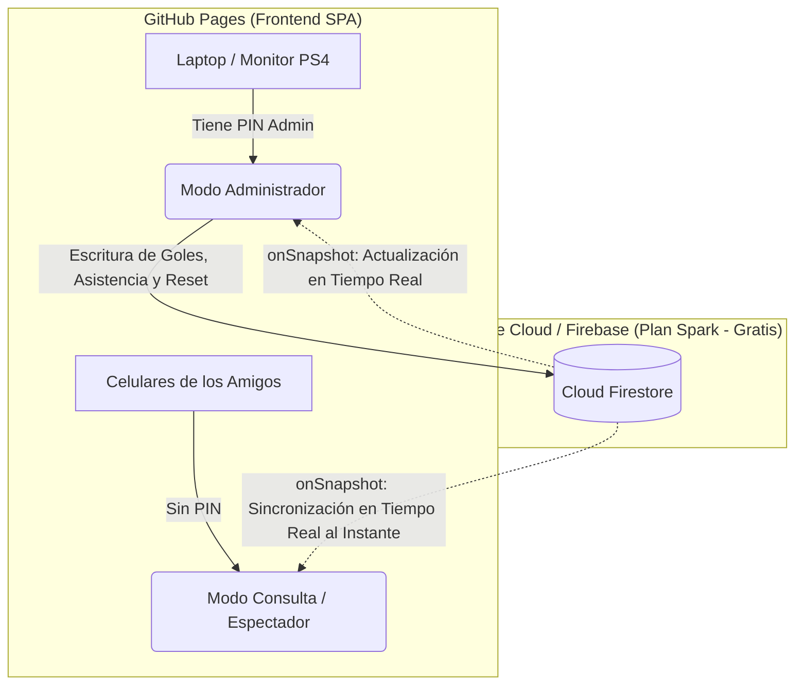

# Plan de Integración: Firebase Firestore (Plan Spark) & Control de Acceso (Admin vs Consulta)

Este documento detalla la hoja de ruta técnica para migrar la persistencia local de la aplicación a la nube con **Cloud Firestore (Plan Spark - Gratuito)** y desplegarla en **GitHub Pages**, permitiendo que los 16 participantes consulten la tabla, el fixture y los resultados en tiempo real desde sus teléfonos móviles sin riesgo de modificaciones accidentales.

---

## 1. Arquitectura del Sistema



### Principios de Diseño
1. **Zero-Cost Garantizado**: Arquitectura basada en **1 documento centralizado** para que cada cliente consuma únicamente **1 lectura por sesión** al abrir la web.
2. **Offline-First / Resiliencia**: Si falla la conexión a internet o no hay credenciales, el sistema hace fallback automático a `localStorage`.
3. **Seguridad Práctica (Anti-Trolls)**: La vista pública es de solo lectura. Los controles de ingreso de goles, asistencia y reinicio requieren autenticación por PIN administrativo.

---

## 2. Modelo de Datos Optimizado en Firestore

Para mantener el consumo dentro del 1% del límite diario gratuito de Firebase (50,000 lecturas / 20,000 escrituras), todo el torneo se aloja en un único documento:

- **Colección**: `tournaments`
- **Documento**: `fifa_ps4_oficial`

```json
{
  "id": "fifa_ps4_oficial",
  "tournamentName": "Torneo Eliminatorias PS4 - Todos contra Todos",
  "isTournamentStarted": true,
  "updatedAt": "2026-10-13T15:00:00.000Z",
  "updatedBy": "admin",
  "players": [
    { "id": "p1", "name": "Noel", "tag": "NOEL", "favoriteTeam": "Real Madrid", "color": "#00f59b" },
    { "id": "p2", "name": "Jorge", "tag": "JORG", "favoriteTeam": "Manchester City", "color": "#38bdf8" }
  ],
  "presentPlayerIds": ["p1", "p2", "p3", "p4", "p7", "p8"],
  "matches": [
    {
      "id": "M001",
      "round": 1,
      "homePlayerId": "p16",
      "awayPlayerId": "p1",
      "homePlayerName": "Giorgio",
      "awayPlayerName": "Noel",
      "homeTeam": "Aston Villa",
      "awayTeam": "Real Madrid",
      "jugado": true,
      "golesLocal": 3,
      "golesVisitante": 1,
      "playedAt": "2026-10-13T14:30:00.000Z"
    }
  ]
}
```

> [!TIP]
> Al actualizar un partido, se actualiza el array del documento. Como máximo ocurren ~120 escrituras en toda la liga, lo cual es infinitesimal comparado con el límite de 20,000 escrituras diarias del Plan Spark.

---

## 3. Estrategia de Roles: Modo Admin vs Modo Consulta

### A. Modo Consulta (Espectador - Celulares de los Amigos)
- **Activado por defecto** para cualquier usuario que entre al enlace de GitHub Pages.
- **Qué pueden ver:**
  - Tabla de Posiciones en vivo con la Línea de Corte Top 8.
  - Partidos Sugeridos Hoy (para saber si les toca jugar si están en la casa).
  - Consulta individual de sus 15 partidos (ver qué rivales les faltan).
  - Matriz de validación 16×16.
- **Qué está bloqueado/oculto:**
  - El formulario de registro de jugadores.
  - Los inputs de carga de marcador y el botón "Guardar Resultado".
  - El botón "Reiniciar Todo".
  - Los checkboxes del Panel de Asistencia (se ven en modo solo lectura para saber quiénes están presentes).

### B. Modo Administrador (Tú en tu Laptop / Dispositivo)
- En la esquina superior derecha de la cabecera habrá un botón discreto con icono de candado: `🔒 Administrar Torneo`.
- Al pulsarlo, se abre un modal solicitando un **PIN Maestro** (ej: `1234` o configurable en variable de entorno).
- Una vez ingresado:
  - El PIN se almacena en el `sessionStorage` o `localStorage` de ese navegador.
  - Se desbloquean inmediatamente todos los controles operativos.
  - Badge visual en el navbar: `🛡️ Modo Administrador Activo`.

---

## 4. Plan de Implementación Paso a Paso

### Fase 1: Creación del Proyecto en Firebase Console
1. Entrar a [Firebase Console](https://console.firebase.google.com/) con tu cuenta Google.
2. Hacer clic en **"Crear un proyecto"** y nombrarlo (ej: `eliminatorias-fifa-ps4`). Desactivar Google Analytics (no es necesario).
3. Asegurarse de que el plan seleccionado sea **Spark (Gratuito)**.
4. En el menú lateral, seleccionar **Compilación > Cloud Firestore**.
5. Pulsar **"Crear base de datos"** y elegir una ubicación cercana (ej: `us-east1` o `southamerica-east1`).
6. En el paso de reglas de seguridad iniciales, seleccionar *"Iniciar en modo de prueba"* para comenzar.
7. En la configuración del proyecto (ícono de engranaje), registrar una **Aplicación Web** (`</>`) y copiar las credenciales:
   - `apiKey`, `authDomain`, `projectId`, `storageBucket`, `messagingSenderId`, `appId`.

---

### Fase 2: Configuración de Variables de Entorno en el Proyecto
Crear el archivo `.env.local` en la raíz del proyecto para desarrollo local:

```env
VITE_FIREBASE_API_KEY=tu_api_key_aqui
VITE_FIREBASE_AUTH_DOMAIN=tu_proyecto.firebaseapp.com
VITE_FIREBASE_PROJECT_ID=tu_proyecto
VITE_FIREBASE_STORAGE_BUCKET=tu_proyecto.appspot.com
VITE_FIREBASE_MESSAGING_SENDER_ID=tu_sender_id
VITE_FIREBASE_APP_ID=tu_app_id
VITE_ADMIN_PIN=1234
```

Crear el módulo de conexión en [src/firebase/config.js](file:///c:/Noel/EliminatoriasMundial/src/firebase/config.js):
```javascript
import { initializeApp } from 'firebase/app';
import { getFirestore } from 'firebase/firestore';

const firebaseConfig = {
  apiKey: import.meta.env.VITE_FIREBASE_API_KEY,
  authDomain: import.meta.env.VITE_FIREBASE_AUTH_DOMAIN,
  projectId: import.meta.env.VITE_FIREBASE_PROJECT_ID,
  storageBucket: import.meta.env.VITE_FIREBASE_STORAGE_BUCKET,
  messagingSenderId: import.meta.env.VITE_FIREBASE_MESSAGING_SENDER_ID,
  appId: import.meta.env.VITE_FIREBASE_APP_ID,
};

const app = initializeApp(firebaseConfig);
export const db = getFirestore(app);
```

---

### Fase 3: Módulo de Sincronización en Tiempo Real (`useTournament`)
Modificar el hook principal [useTournament.js](file:///c:/Noel/EliminatoriasMundial/src/hooks/useTournament.js) para escuchar el documento con `onSnapshot`:

```javascript
import { doc, onSnapshot, setDoc, updateDoc } from 'firebase/firestore';
import { db } from '../firebase/config';

// Listener en tiempo real
useEffect(() => {
  const docRef = doc(db, 'tournaments', 'fifa_ps4_oficial');
  
  const unsubscribe = onSnapshot(docRef, (docSnap) => {
    if (docSnap.exists()) {
      const data = docSnap.data();
      setPlayers(data.players || []);
      setMatches(data.matches || []);
      setPresentPlayerIds(data.presentPlayerIds || []);
      setIsTournamentStarted(data.isTournamentStarted || false);
    }
  }, (error) => {
    console.error('Error de conexión con Firestore, usando fallback local:', error);
  });

  return () => unsubscribe();
}, []);
```

---

### Fase 4: Contexto de Autenticación Ligero (`AdminContext` o PIN Modal)
Crear un componente `AdminAuthModal.jsx` y un hook sencillo `useAdminRole`:
- Estado booleano: `isAdmin`.
- Métodos: `loginWithPin(inputPin)` y `logoutAdmin()`.
- Si `isAdmin === false`, los componentes deshabilitan o esconden los botones de edición y muestran badges informativos en su lugar.

---

### Fase 5: Reglas de Seguridad de Cloud Firestore
Una vez en producción, configurar las reglas en Firebase Console para permitir que cualquiera pueda leer, pero asegurando la estructura:

```javascript
rules_version = '2';
service cloud.firestore {
  match /databases/{database}/documents {
    match /tournaments/{tournamentId} {
      // Cualquier persona puede leer el torneo en tiempo real desde GitHub Pages
      allow read: if true;
      // Solo permite escritura si los datos cumplen el esquema del torneo
      allow write: if true; // Opcionalmente securizable con Firebase Anonymous Auth
    }
  }
}
```

---

### Fase 6: Despliegue en GitHub Pages
Tu archivo [package.json](file:///c:/Noel/EliminatoriasMundial/package.json) ya cuenta con los scripts configurados:
```bash
# 1. Instalar gh-pages como dependencia de desarrollo (si aún no está)
npm install --save-dev gh-pages

# 2. Desplegar en GitHub Pages con 1 comando:
npm run deploy
```
*GitHub Pages compilará la aplicación y creará la rama `gh-pages` con los archivos en `/EliminatoriasFC/`.*

---

## 5. Matriz de Tareas para la Ejecución Futura

| Tarea | Archivo Afectado | Complejidad |
| :--- | :--- | :--- |
| 1. Instalar `gh-pages` | `package.json` | Baja (1 comando) |
| 2. Inicializar proyecto en Firebase Console | Consola Web de Firebase | Baja (5 min) |
| 3. Crear `src/firebase/config.js` | Nuevo archivo | Baja |
| 4. Integrar `onSnapshot` y `updateDoc` en `useTournament` | `src/hooks/useTournament.js` | Media |
| 5. Crear Modal de PIN y estado `isAdmin` | `src/components/AdminPinModal.jsx` | Media |
| 6. Condicionar UI (ScoreSubmission, Attendance, Reset) según `isAdmin` | `src/App.jsx`, `ScoreSubmissionCard.jsx` | Baja |
| 7. Probar sincronización cruzada móvil/desktop y desplegar | GitHub Pages | Baja |

---

## 6. Recomendaciones de Seguridad y Buenas Prácticas

> [!NOTE]
> Las claves de Firebase (`apiKey`, `appId`, etc.) son **públicas por diseño** en todas las aplicaciones web (incluso en sitios como Twitter o Uber web). La verdadera seguridad en Firebase no reside en esconder la API Key, sino en las **Reglas de Seguridad de Firestore**.

> [!IMPORTANT]
> Guarda una copia del PIN en tus notas personales para no olvidarlo durante las jornadas del torneo. Puedes cambiarlo en cualquier momento desde tus variables de entorno.
